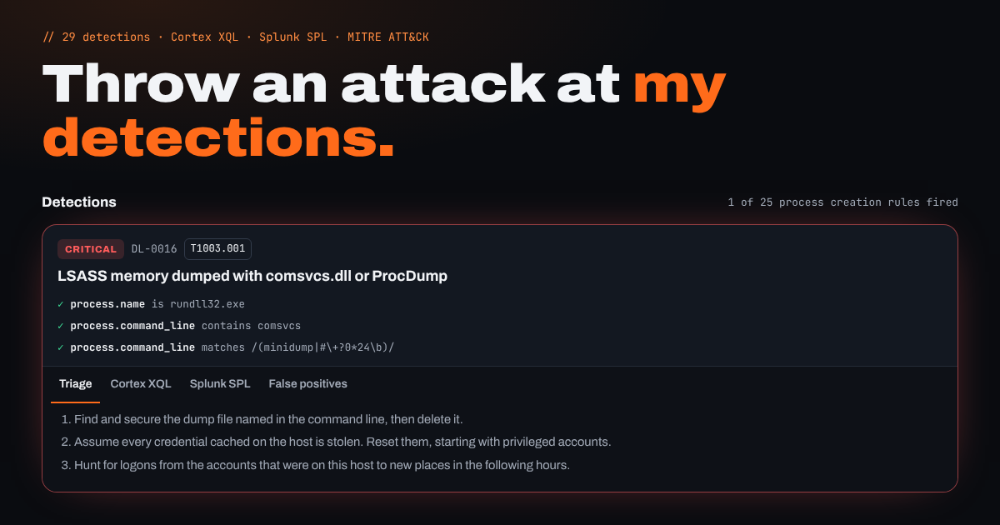

<h1 align="center">Detection Library</h1>

<p align="center">
  <b>Write a detection once. Get Cortex XDR XQL and Splunk SPL. Prove it with test events.</b><br>
  79 hunts for the things that actually show up in intrusions, from the first macro to deleted shadow copies:<br>
  full Active Directory attack coverage (Kerberos, delegation, ACL abuse, AD CS, DCSync, trusts, AMSI bypasses)<br>
  Linux web server exploitation such as PHP2Shell (CVE-2026-109618, CVE-2026-109619)<br>
  FortiGate compromise you can catch with nothing but the firewall's own logs<br>
  and Entra ID backdoors planted through a trusted vendor app (Storm-0940, ConnectWise).<br>
  <b>Try them live: <a href="https://detections.rayenskhiri.online">detections.rayenskhiri.online</a></b>
</p>

<p align="center">
  <a href="https://github.com/Raynskhiri/detection-library/actions/workflows/tests.yml"></a>
  <a href="https://github.com/Raynskhiri/detection-library/actions/workflows/security.yml"></a>
  <a href="https://github.com/Raynskhiri/detection-library/releases/tag/latest"></a>
  
  
  
  
  
</p>

---

## Why this exists

Most query collections are a folder of strings. Nobody knows if they still work, what they
miss, or what to do when one fires. Every rule here comes with four things:

1. **One source of truth.** A short YAML rule with portable field names.
2. **Two native outputs.** Ready-to-paste XQL for Cortex XDR (`xdr_data`) and SPL for Splunk with Sysmon and Windows event logs.
3. **Proof.** Events that must fire and events that must not. CI runs the rule *and the compiled XQL and SPL* against them.
4. **What to do next.** Triage steps and the false positives you will actually meet.

## Detection Playground

[](https://detections.rayenskhiri.online)

**[detections.rayenskhiri.online](https://detections.rayenskhiri.online)** runs every rule in your browser:

* **Type a command line or paste a Sysmon, Security or PowerShell event** (XML from Event Viewer, or JSON) and see which rules fire, why each one fired, the triage steps, and the XQL and SPL to copy.
* **Replay an intrusion**: twelve steps from a phishing document to ransomware, with one step of normal admin work in the middle. Watch each detection light up on an ATT&CK board, and check that the normal step stays quiet.
* **Nothing leaves the page.** No backend, no analytics, a strict Content Security Policy.

The page uses a small JavaScript engine ([`site/engine.js`](site/engine.js)). CI checks it against the Python reference on more than 800 events, so the playground can't drift from the rules.

## One rule, both languages

```yaml
id: DL-0016
title: LSASS memory dumped with comsvcs.dll or ProcDump
attack: [T1003.001]
logsource: process_creation
detection:
  comsvcs:
    process.name: rundll32.exe
    process.command_line|contains: comsvcs
  minidump:
    process.command_line|re: '(minidump|#\+?0*24\b)'
  procdump:
    process.name: [procdump.exe, procdump64.exe, procdump64a.exe]
    process.command_line|contains: lsass
  condition: (comsvcs and minidump) or procdump
tests:
  match:
    - process.name: rundll32.exe
      process.command_line: 'rundll32 comsvcs.dll #24 624 C:\Users\Public\x.bin full'
  no_match:
    - process.name: rundll32.exe
      process.command_line: 'rundll32.exe comsvcs.dll,DllRegisterServer'
```

becomes

```sql
config case_sensitive = false
| dataset = xdr_data
| filter event_type = ENUM.PROCESS and event_sub_type = ENUM.PROCESS_START
| filter (action_process_image_name = "rundll32.exe" and action_process_image_command_line contains "comsvcs"
          and action_process_image_command_line ~= "(?i)(minidump|#\\+?0*24\\b)")
      or (action_process_image_name in ("procdump.exe", "procdump64.exe", "procdump64a.exe")
          and action_process_image_command_line contains "lsass")
| fields _time, agent_hostname, actor_effective_username, actor_process_image_name, action_process_image_name, action_process_image_command_line
```

and

```
`sysmon` EventCode=1
| eval process_name=lower(mvindex(split(Image,"\\"),-1)), parent_name=lower(mvindex(split(ParentImage,"\\"),-1))
| where (lower(process_name)="rundll32.exe" AND match(CommandLine, "(?i)comsvcs") AND match(CommandLine, "(?i)(minidump|#\\+?0*24\\b)"))
     OR ((lower(process_name)="procdump.exe" OR ...) AND match(CommandLine, "(?i)lsass"))
| table _time host User ParentImage Image CommandLine
```

(Wrapped here for reading; the generated files are in [`build/`](build) and on each rule's page.)

## The rules

<!-- rules:start -->
| ID | Detection | ATT&CK | Tactic | Severity |
|---|---|---|---|---|
| [DL-0063](docs/rules/DL-0063.md) | Web server or PHP worker starts a shell or download tool (Linux) | T1190, T1059.004, T1505.003 | initial-access | high |
| [DL-0066](docs/rules/DL-0066.md) | PHP ran out of memory before any script line ran (PHP2Shell probe) | T1190 | initial-access | medium |
| [DL-0067](docs/rules/DL-0067.md) | Web server or PHP-FPM worker crashed with a segmentation fault | T1190 | initial-access | medium |
| [DL-0068](docs/rules/DL-0068.md) | FortiGate admin login through FortiCloud SSO or from an internet address | T1190, T1078 | initial-access | high |
| [DL-0074](docs/rules/DL-0074.md) | Admin or SSL VPN login with an account name used in FortiGate intrusions | T1078, T1133 | initial-access | medium |
| [DL-0078](docs/rules/DL-0078.md) | ConnectWise / SkyKick app signed in from a public IPv4 address or Storm-0940 infrastructure | T1199, T1078.004, T1195 | initial-access | high |
| [DL-0001](docs/rules/DL-0001.md) | PowerShell with an encoded command | T1059.001, T1027 | execution | high |
| [DL-0002](docs/rules/DL-0002.md) | PowerShell download cradle that runs what it fetched | T1059.001, T1105 | execution | high |
| [DL-0003](docs/rules/DL-0003.md) | Office application starts a shell or script host | T1204.002, T1566.001 | execution | high |
| [DL-0004](docs/rules/DL-0004.md) | mshta runs a remote HTA or inline script | T1218.005 | execution | high |
| [DL-0005](docs/rules/DL-0005.md) | regsvr32 loads a remote scriptlet (Squiblydoo) | T1218.010 | execution | high |
| [DL-0006](docs/rules/DL-0006.md) | rundll32 runs script or loads from a URL | T1218.011 | execution | high |
| [DL-0007](docs/rules/DL-0007.md) | Script host runs a script from a user-writable folder | T1059.005, T1059.007 | execution | medium |
| [DL-0008](docs/rules/DL-0008.md) | WMIC creates a process, locally or on another host | T1047 | execution | medium |
| [DL-0039](docs/rules/DL-0039.md) | SQL Server starts a shell (xp_cmdshell) | T1059.003, T1505.001 | execution | high |
| [DL-0044](docs/rules/DL-0044.md) | Offensive PowerShell toolkit loaded (PowerView, PowerUp, Invoke-Mimikatz) | T1059.001, T1087.002, T1003.001 | execution | high |
| [DL-0064](docs/rules/DL-0064.md) | Reverse shell one-liner on Linux | T1059.004, T1059.006 | execution | critical |
| [DL-0009](docs/rules/DL-0009.md) | Run key points to a user-writable path or a script host | T1547.001 | persistence | medium |
| [DL-0010](docs/rules/DL-0010.md) | Scheduled task created to run a script host or a file in a user-writable path | T1053.005 | persistence | medium |
| [DL-0011](docs/rules/DL-0011.md) | Service created with a suspicious binary path | T1543.003, T1569.002 | persistence | high |
| [DL-0037](docs/rules/DL-0037.md) | Account added to the local Administrators group from the command line | T1098 | persistence | high |
| [DL-0041](docs/rules/DL-0041.md) | DSRM administrator allowed to log on normally (DsrmAdminLogonBehavior) | T1098, T1112 | persistence | critical |
| [DL-0045](docs/rules/DL-0045.md) | Security descriptor backdoor on WMI, PS Remoting, remote registry or AdminSDHolder | T1098, T1546.003, T1112 | persistence | critical |
| [DL-0054](docs/rules/DL-0054.md) | Key credential added to an account (shadow credentials) | T1098, T1556 | persistence | high |
| [DL-0056](docs/rules/DL-0056.md) | Permissions changed on AdminSDHolder or the domain root | T1098, T1222.001 | persistence | critical |
| [DL-0057](docs/rules/DL-0057.md) | Member added to a privileged domain group | T1098.007 | persistence | high |
| [DL-0059](docs/rules/DL-0059.md) | DSRM administrator password changed | T1098 | persistence | high |
| [DL-0065](docs/rules/DL-0065.md) | PHP file written in the web root by the web server or PHP worker | T1505.003 | persistence | medium |
| [DL-0069](docs/rules/DL-0069.md) | New administrator account created on a FortiGate | T1136.001, T1098 | persistence | high |
| [DL-0071](docs/rules/DL-0071.md) | FortiGate firewall policy set to accept any source to any destination | T1562.004, T1133 | persistence | high |
| [DL-0073](docs/rules/DL-0073.md) | FortiGate automation stitch, action or auto-script created | T1053, T1059 | persistence | medium |
| [DL-0077](docs/rules/DL-0077.md) | Secret or certificate added to an Entra ID app by another app or by a script | T1098.001 | persistence | high |
| [DL-0034](docs/rules/DL-0034.md) | AD object rights or memberships changed with PowerView or StandIn | T1098 | privilege-escalation | high |
| [DL-0038](docs/rules/DL-0038.md) | Service binary path changed with sc config | T1574.011, T1543.003 | privilege-escalation | high |
| [DL-0051](docs/rules/DL-0051.md) | Service ticket issued through delegation (S4U2Proxy) | T1558, T1134.001 | privilege-escalation | low |
| [DL-0052](docs/rules/DL-0052.md) | Resource-based constrained delegation written on an object | T1098, T1134.001 | privilege-escalation | high |
| [DL-0053](docs/rules/DL-0053.md) | Constrained delegation configured on an account | T1098, T1134.001 | privilege-escalation | medium |
| [DL-0058](docs/rules/DL-0058.md) | SID history added to an account | T1134.005 | privilege-escalation | critical |
| [DL-0076](docs/rules/DL-0076.md) | Privileged Entra ID role given to a service principal by an application | T1098.003 | privilege-escalation | critical |
| [DL-0079](docs/rules/DL-0079.md) | Tenant-wide Microsoft Graph or Exchange permission granted to an app | T1098.003, T1528 | privilege-escalation | high |
| [DL-0012](docs/rules/DL-0012.md) | Microsoft Defender disabled or given exclusions | T1562.001 | defense-evasion | high |
| [DL-0013](docs/rules/DL-0013.md) | Windows event logs cleared from the command line | T1070.001 | defense-evasion | high |
| [DL-0014](docs/rules/DL-0014.md) | Windows system process name running from the wrong folder | T1036.005 | defense-evasion | high |
| [DL-0015](docs/rules/DL-0015.md) | certutil used to download or decode a file | T1105, T1140 | defense-evasion | high |
| [DL-0033](docs/rules/DL-0033.md) | In-memory .NET loader runs an offensive tool | T1620, T1562.001, T1027 | defense-evasion | high |
| [DL-0040](docs/rules/DL-0040.md) | .NET profiler set to load a DLL (COR_PROFILER) | T1574.012, T1562.001 | defense-evasion | high |
| [DL-0042](docs/rules/DL-0042.md) | LSA protection or credential caching weakened in the registry | T1562.001, T1003.001 | defense-evasion | high |
| [DL-0043](docs/rules/DL-0043.md) | AMSI or ETW bypass in a PowerShell script block | T1562.001 | defense-evasion | high |
| [DL-0072](docs/rules/DL-0072.md) | FortiGate log forwarding turned off or pointed somewhere else | T1562.006, T1562.008 | defense-evasion | high |
| [DL-0016](docs/rules/DL-0016.md) | LSASS memory dumped with comsvcs.dll or ProcDump | T1003.001 | credential-access | critical |
| [DL-0017](docs/rules/DL-0017.md) | SAM, SYSTEM, SECURITY hives or NTDS.dit copied for offline cracking | T1003.002, T1003.003, T1003.004 | credential-access | critical |
| [DL-0018](docs/rules/DL-0018.md) | Kerberoasting or AS-REP roasting tool run | T1558.003, T1558.004 | credential-access | high |
| [DL-0019](docs/rules/DL-0019.md) | Mimikatz modules on the command line | T1003.001, T1003.006, T1550.002, T1558.001 | credential-access | critical |
| [DL-0031](docs/rules/DL-0031.md) | Rubeus requests, forges or injects Kerberos tickets | T1558, T1550.003, T1550.002 | credential-access | critical |
| [DL-0032](docs/rules/DL-0032.md) | AD CS abuse tool looks for or requests vulnerable certificates | T1649 | credential-access | high |
| [DL-0046](docs/rules/DL-0046.md) | DCSync, directory replication requested by an account that is not a DC | T1003.006 | credential-access | critical |
| [DL-0047](docs/rules/DL-0047.md) | Kerberos service ticket with RC4 for a user service account (Kerberoasting) | T1558.003 | credential-access | medium |
| [DL-0048](docs/rules/DL-0048.md) | TGT issued without Kerberos pre-authentication (AS-REP roasting) | T1558.004 | credential-access | high |
| [DL-0050](docs/rules/DL-0050.md) | TGT requested with a certificate (PKINIT) | T1649, T1550 | credential-access | medium |
| [DL-0055](docs/rules/DL-0055.md) | Service principal name added to a user account (targeted Kerberoasting) | T1558.003, T1098 | credential-access | medium |
| [DL-0061](docs/rules/DL-0061.md) | Certificate issued with a subject alternative name supplied in the request | T1649 | credential-access | high |
| [DL-0062](docs/rules/DL-0062.md) | Remote access to the print spooler or EFS pipe (authentication coercion) | T1187 | credential-access | medium |
| [DL-0070](docs/rules/DL-0070.md) | FortiGate configuration backed up or downloaded | T1552.001, T1005 | credential-access | high |
| [DL-0020](docs/rules/DL-0020.md) | Domain admin groups, domain controllers or trusts enumerated with built-in tools | T1069.002, T1087.002, T1482, T1018 | discovery | medium |
| [DL-0021](docs/rules/DL-0021.md) | BloodHound collector (SharpHound) run | T1087.002, T1069.002, T1482 | discovery | high |
| [DL-0030](docs/rules/DL-0030.md) | PowerView or PowerSploit AD recon functions on the command line | T1087.002, T1069.002, T1482, T1135 | discovery | high |
| [DL-0022](docs/rules/DL-0022.md) | PsExec service runs a command | T1569.002, T1021.002 | lateral-movement | medium |
| [DL-0023](docs/rules/DL-0023.md) | Impacket wmiexec or smbexec style command | T1047, T1021.002, T1569.002 | lateral-movement | high |
| [DL-0024](docs/rules/DL-0024.md) | Command started through WinRM remoting | T1021.006 | lateral-movement | medium |
| [DL-0036](docs/rules/DL-0036.md) | winrs runs a command on another host | T1021.006 | lateral-movement | medium |
| [DL-0049](docs/rules/DL-0049.md) | TGT requested with RC4 encryption (possible overpass-the-hash) | T1550.002 | lateral-movement | medium |
| [DL-0060](docs/rules/DL-0060.md) | Logon with new credentials (logon type 9, overpass-the-hash) | T1550.002, T1134.002 | lateral-movement | medium |
| [DL-0025](docs/rules/DL-0025.md) | Living-off-the-land binary connects to the internet | T1105, T1218 | command-and-control | medium |
| [DL-0026](docs/rules/DL-0026.md) | Connection to common Tor ports from a non-Tor process | T1090.003 | command-and-control | medium |
| [DL-0027](docs/rules/DL-0027.md) | Script host or LOLBin looks up a paste site, file drop or tunnel service | T1102, T1105, T1572 | command-and-control | medium |
| [DL-0035](docs/rules/DL-0035.md) | netsh port proxy set up to forward traffic | T1090.001 | command-and-control | medium |
| [DL-0075](docs/rules/DL-0075.md) | MeshAgent or Pulseway started, or a program run from ProgramData\USOShared | T1219, T1036.005 | command-and-control | high |
| [DL-0028](docs/rules/DL-0028.md) | rclone copies data to a remote | T1567.002, T1048 | exfiltration | high |
| [DL-0029](docs/rules/DL-0029.md) | Shadow copies, backups or boot recovery removed | T1490 | impact | critical |
<!-- rules:end -->

ATT&CK Navigator layer: [`build/attack-navigator-layer.json`](build/attack-navigator-layer.json). Open it at
[mitre-attack.github.io/attack-navigator](https://mitre-attack.github.io/attack-navigator/) to see the coverage map.

## Use it

**Cortex XDR:** open a rule page in [`docs/rules`](docs/rules), copy the XQL into *Query Builder → XQL Search*,
or take the file from [`build/xql`](build/xql). Good candidates for BIOCs or scheduled correlation rules once tuned.

**Splunk:** the SPL uses a `sysmon` macro so it fits any index layout. Define it once:

```
[sysmon]
definition = index=sysmon source="XmlWinEventLog:Microsoft-Windows-Sysmon/Operational"
```

The Windows event rules (Security on the DCs and CA, PowerShell 4104) use a `wineventlog` macro:

```
[wineventlog]
definition = index=wineventlog (source="XmlWinEventLog:Security" OR source="XmlWinEventLog:Microsoft-Windows-PowerShell/Operational")
```

(Settings → Advanced search → Search macros. Field names follow the Splunk Add-on for Sysmon and the Splunk Add-on for Microsoft Windows with XML rendering.)

The web server rules (Apache error log, PHP errors) use an `apache_error` macro:

```
[apache_error]
definition = index=web sourcetype=apache:error
```

In Cortex XDR they read the Apache error log sent with an XDR Collector or a broker, in a dataset named `apache_httpd_raw`.
If your dataset has another name, change the `dataset =` line. Linux process and file rules use the XDR agent's normal
telemetry (`xdr_data`) and, in Splunk, Sysmon for Linux.

The FortiGate rules (DL-0068 to DL-0074) need only the firewall's own syslog. In Cortex XDR, point the FortiGate at a
Broker VM syslog applet; the logs land in `fortinet_fortigate_raw` and the queries pull each field out of `_raw_log`, so
they work with or without the Fortinet parser. In Splunk, install the Fortinet FortiGate Add-on and define:

```
[fortigate]
definition = index=network sourcetype=fortigate_event OR sourcetype=fortigate_traffic
```

Keep the system event log on and keep at least 60 days of it: in the 2026 campaigns, short retention is why responders
could not find how the attackers got in.

The Entra ID rules (DL-0076 to DL-0079) need no agent at all, only the tenant's audit and service principal
sign-in logs. In Cortex XDR, connect the Office 365 / Entra ID data source; audit records land in
`msft_azure_ad_audit_raw` and sign-ins in `msft_azure_ad_raw`, with columns named after the Microsoft Graph
`directoryAudit` and `signIn` resources (`activityDisplayName`, `initiatedBy`, `targetResources`, `appId`,
`ipAddress`...). If you ingest through Event Hub instead (`msft_azure_raw`), the same values sit under
`properties.*`: change the `alter` lines. In Splunk, the Splunk Add-on for Microsoft Cloud Services writes
`azure:monitor:aad`; define:

```
[azure_monitor_aad]
definition = sourcetype=azure:monitor:aad
```

Export *ServicePrincipalSignInLogs* in the tenant's diagnostic settings as well as *AuditLogs*: app-only sign-ins are
not in the normal sign-in log, and that is exactly where supply chain abuse shows up.

**What has to be logged.** The Active Directory rules only see what Windows writes, so turn on: *Audit Directory Service Access*
and *Directory Service Changes* on the DCs with a SACL on the domain root and AdminSDHolder (4662, 5136), *Kerberos Service Ticket
Operations* and *Kerberos Authentication Service* (4768, 4769), *Security Group Management* (4728, 4732, 4756), *Certification
Services* on the CA (4886, 4887), *Detailed File Share* (5145), and PowerShell script block logging (4104). In Cortex XDR, make sure
these event IDs are in the Windows event log collection of the agent profile for DCs and the CA.

**From the command line:**

```bash
pip install -r requirements.txt
python -m detlib show DL-0046       # print one rule in both languages
python -m detlib test               # run every rule against its test events
python -m detlib build              # regenerate build/, docs/rules/ and the table above
```

## Write a rule

Copy any file in [`rules/`](rules), give it the next ID, and fill in:

| Key | What goes in it |
|---|---|
| `logsource` | `process_creation`, `network_connection`, `dns_query`, `registry_set`, `file_event`, `windows_event`, `web_server_error`, `fortigate`, `entra_audit` or `entra_sp_signin` |
| `detection` | named selections plus a `condition` using `and`, `or`, `not` and parentheses |
| field modifiers | none (equals), `contains`, `startswith`, `endswith`, `re`, `cidr`, and `all` to require every value |
| `tests` | at least one `match` and one `no_match` event, using the same portable field names |
| `triage`, `false_positives` | what an analyst should do, and what will fool the rule |

Inside a selection every field must match. A list of values means *any of them*. Matching is case-insensitive.
Field names per log source are in [`detlib/schema.py`](detlib/schema.py).

## How it is tested

* **Reference matcher.** Each rule runs against its own events (`python -m detlib test`): 79 rules, 270 events.
* **Compiled output, executed.** The test suite carries a small interpreter for the subset of XQL and SPL the
  compiler emits ([`tests/interp.py`](tests/interp.py)). Every test event is mapped to XDR and Sysmon column names
  and run through the *generated* query. Both must agree with the reference.
* **Missing fields.** Each field is removed from each event in turn. XQL and SPL drop a row when a filter is null,
  so a careless `not filter` would silently hide events that lack the field. The compiler adds null guards, and the
  tests prove they work.
* **Mutation-checked.** Removing the null guard, the `(?i)` flag or the string escaping makes the suite fail.
* **Browser engine.** The playground's JavaScript engine is run in Node against every test event, every event with a field removed, and the intrusion scenario. Python and JavaScript must give the same answer.
* **Intrusion scenario.** [`scenarios/intrusion.yml`](scenarios/intrusion.yml) lists the exact rules each step must fire, including a benign step that must fire nothing.
* **Drift.** CI fails if `build/`, `docs/` or `site/data/` are out of date with the rules.

## CI/CD

| Pipeline | What it does |
|---|---|
| [Tests](.github/workflows/tests.yml) | Python 3.10, 3.12 and 3.13, plus the browser engine in Node, on every push and pull request |
| [Release](.github/workflows/release.yml) | When Tests pass on `main`, publishes the XQL and SPL packs, the ATT&CK layer and checksums to the [`latest` release](https://github.com/Raynskhiri/detection-library/releases/tag/latest). A `v*` tag creates a versioned release |
| [Security](.github/workflows/security.yml) | gitleaks secret scan, CodeQL (Python and JavaScript, security-extended), pip-audit, weekly |
| Deploy | Vercel redeploys the playground from `site/` on every push to `main` |
| [Dependabot](.github/dependabot.yml) | Weekly updates for Actions and pip |

**Honest limit:** the interpreter is not Cortex and not Splunk. For Windows events, the XQL reads named values with
`json_extract_scalar(action_evtlog_data_fields, "$.Name")`; check the field names on your tenant once before you rely on it. The generated queries have not yet been run
against a live XDR tenant or Splunk instance from this repository. If one errors on your platform, please open
an issue with the message.

## Related

* [Maghreb Threat Watch](https://github.com/Raynskhiri/maghreb-threat-watch): daily lookalike-domain watch for North
  African brands. It publishes its own XQL and SPL hunts for the domains it finds.
* [MalwareScope](https://github.com/Raynskhiri/MalwareScope): sandbox and ML malware analysis. Its behavioural
  scorer looks at the same techniques these rules hunt for.

## Author

**Rayen Skhiri**, SOC analyst and AppSec engineer · [rayenskhiri.online](https://rayenskhiri.online) ·
[LinkedIn](https://www.linkedin.com/in/rayen-skhiri)

MIT licensed. Test events are synthetic: the IPs are from documentation ranges and the names are made up.
